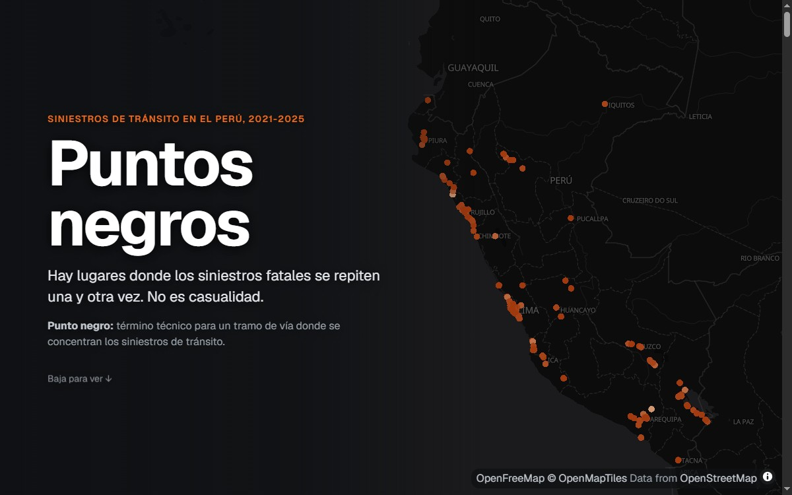
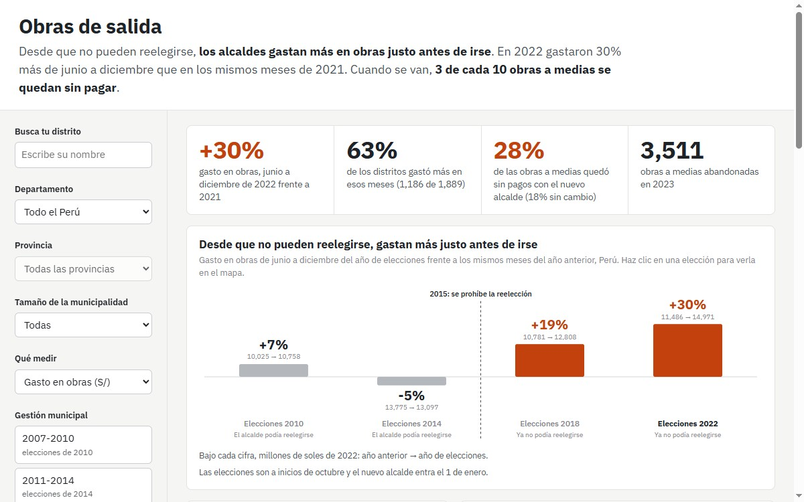
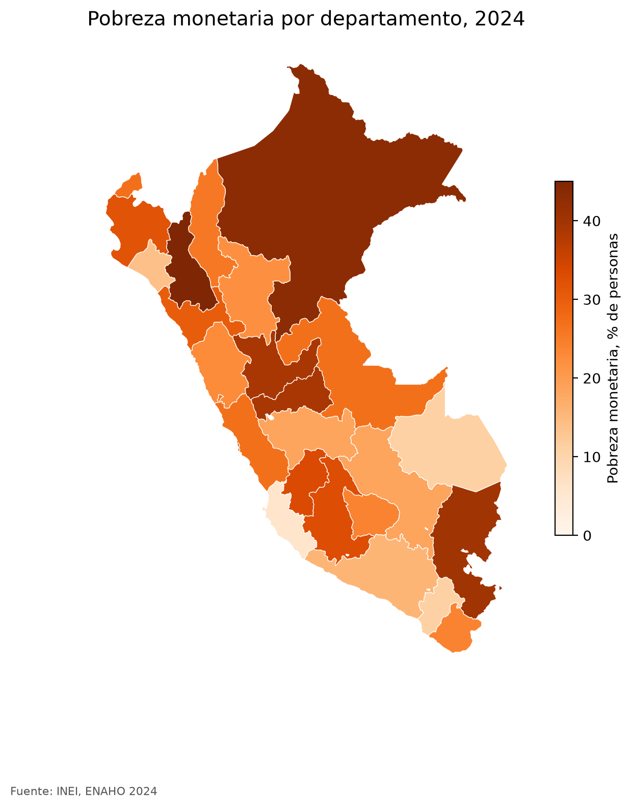

Politólogo por la PUCP y consultor de asuntos públicos en Vali Consultores, donde sigo la agenda legislativa y regulatoria de los sectores Pharma, Crop y Tech en la región andina.
Uso Python, R y datos abiertos para responder preguntas sobre el Estado peruano, desde el gasto municipal hasta la seguridad vial.

[CV en PDF](/files/CV_Nicolas_Silva.pdf){: .btn .btn--primary} [GitHub](https://github.com/nicosil02){: .btn .btn--inverse} [LinkedIn](https://www.linkedin.com/in/nicolas-silva0522a){: .btn .btn--inverse} [Correo](mailto:nicolas.silva@pucp.edu.pe){: .btn .btn--inverse}

## Proyectos

  <a href="/portfolio/1-puntos-negros/"><strong>Puntos negros</strong>286 lugares concentran 1 de cada 9 fallecidos en las vías del Perú</a>
  <a href="/portfolio/2-obras-de-salida/"><strong>Obras de salida</strong>Sin reelección, los alcaldes gastaron 30% más en obras antes de irse</a>
  <a href="/portfolio/3-skills-enaho/"><strong>Skills para la ENAHO</strong>Un agente que replica la pobreza oficial de 2024, 27.6%</a>

## Demo

Dashboard de Puntos negros. Baja dentro del recuadro para recorrerlo o [ábrelo en pantalla completa](https://nicosil02.github.io/puntos-negros/).

  <iframe src="https://nicosil02.github.io/puntos-negros/" title="Dashboard Puntos negros" loading="lazy"></iframe>

## Publicaciones

- Silva Andújar, N. (2026). *De democracias y desencantos. Una radiografía de los determinantes de las actitudes frágiles hacia la democracia en los países andinos (2020-2023)*. Tesis de licenciatura, PUCP. Presentada en el XIII Congreso de ALACIP, Buenos Aires. [Repositorio PUCP](http://hdl.handle.net/20.500.12404/33570)
- Silva Andújar, N., Marrou Rivera, M. J. y Monzón, H. (2024). La judicialización de los derechos reproductivos en perspectiva comparada. El Anticonceptivo Oral de Emergencia en Perú (2006-2009) y Chile (2007-2008). *Politai*, 15(24), 129-154. [DOI](https://doi.org/10.18800/politai.202401.006)
