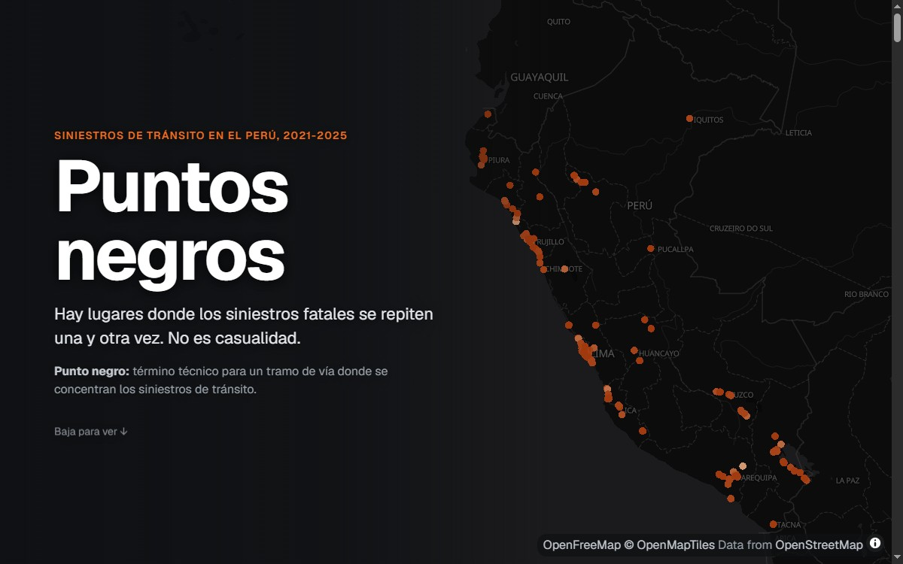

**Pregunta.** Entre 2021 y 2025, ¿dónde se repiten los siniestros fatales en las vías del Perú y qué tienen en común esos lugares?

**Resultado.** Hay 286 lugares de 200 metros con 3 o más siniestros fatales, y ahí se registró 1 de cada 9 fallecidos. No es casualidad. Si los mismos siniestros cayeran al azar sobre las mismas vías, habría 31 lugares con 5 o más siniestros fatales en vez de 55. La mitad de los siniestros en puntos negros son atropellos y 44% ocurrió a menos de 200 metros de un paradero.

**Cómo.** 9,105 siniestros fatales del Observatorio Nacional de Seguridad Vial unidos a las vías de OpenStreetMap, agrupados con DBSCAN y comparados con 20 simulaciones al azar sobre la misma vía. Además, una auditoría a ciegas con imágenes satelitales de 28 pares de punto negro y tramo de control.

[Dashboard](https://nicosil02.github.io/puntos-negros/){: .btn .btn--primary} [Repositorio](https://github.com/nicosil02/puntos-negros){: .btn .btn--inverse} [Publicación y reel en LinkedIn](https://www.linkedin.com/posts/nicolas-silva0522a_seguridadvial-cienciadedatos-polaedticaspaeqblicas-ugcPost-7522435075381022720-kr2F){: .btn .btn--inverse}

  <iframe src="https://nicosil02.github.io/puntos-negros/" title="Dashboard Puntos negros" loading="lazy"></iframe>

