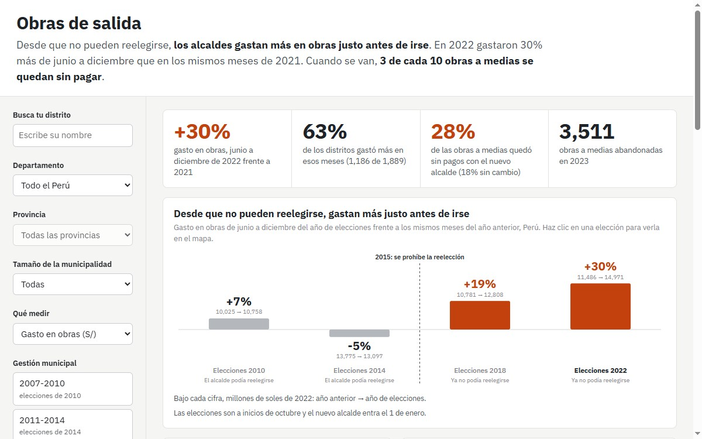

**Pregunta.** ¿Los alcaldes del Perú dejan la plata de obras para el final de su gestión? ¿Y qué pasa con esas obras cuando entra el siguiente?

**Resultado.** Desde que no pueden reelegirse, gastan más justo antes de irse. En 2022 gastaron 30% más en obras de junio a diciembre que en los mismos meses de 2021, y 63% de los distritos gastó más. Con el cambio de alcalde, 28% de las obras a medias se quedó sin pagos (18% en años sin cambio). Solo en 2023 fueron 3,511 obras abandonadas.

**Cómo.** Pagos mensuales de cada obra de las casi 1,900 municipalidades entre 2007 y 2026 (MEF, Datos Abiertos), en soles de 2022 con el IPC del BCRP, cruzados con los resultados electorales de la ONPE y las autoridades electas del JNE.

[Dashboard](https://nicosil02.github.io/obras-de-salida/){: .btn .btn--primary} [Repositorio](https://github.com/nicosil02/obras-de-salida){: .btn .btn--inverse}
