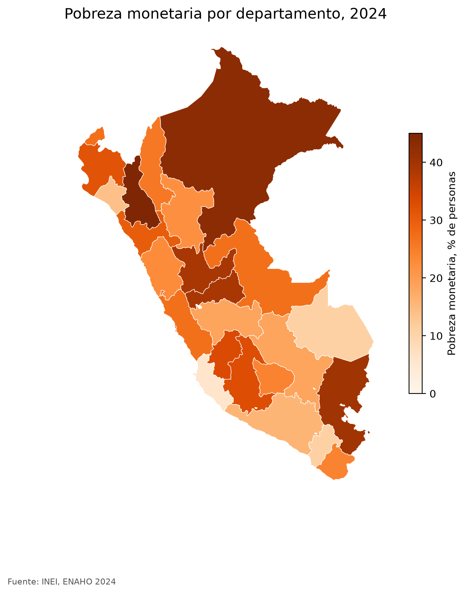

**Pregunta.** ¿Puede un agente descargar y limpiar la Encuesta Nacional de Hogares del INEI y replicar la cifra oficial de pobreza?

**Resultado.** Sí. Con un solo pedido («haz un mapa de la pobreza por departamento con la ENAHO 2024») las cuatro skills se encadenan y dan 27.6% de pobreza monetaria y 5.5% de pobreza extrema, igual que el INEI, con los 25 departamentos iguales a la cifra oficial. Si la limpieza no replica esas cifras, se detiene.

**Cómo.** Cuatro skills de Claude Code, una por paso (descargar, limpiar, graficar y mapear), con scripts en Python que también se pueden correr sin Claude.

[Repositorio](https://github.com/nicosil02/enaho-skills){: .btn .btn--primary} [Mapa](https://github.com/nicosil02/enaho-skills/blob/main/mapas/pobreza_departamento.png){: .btn .btn--inverse}
